# `acropin-food-images`

An open, community-maintained catalog of normalized food images for restaurant menus and food applications. Every image is distributed as a 480 × 480 WebP and includes its dish name, tags, source, and per-image license information.

## Install

```sh
npm install acropin-food-images
```

## Use an image in a menu

```tsx
import { getFoodImage } from 'acropin-food-images';

const image = getFoodImage('margherita-pizza');

export function MenuItem() {
  return image ?  : null;
}
```

You can also use the URL helper or search by text, tag, and license:

```ts
import { getFoodImageUrl, searchFoodImages } from 'acropin-food-images';

const url = getFoodImageUrl('margherita-pizza');
const vegetarian = searchFoodImages('pizza', { tags: ['vegetarian'] });
```

Image URLs point to the immutable npm package version on jsDelivr. Metadata is available locally from `foodImages` or `./catalog.json`; the source WebP can be imported with `acropin-food-images/assets/<slug>.webp` in bundlers that support asset imports.

## How community images reach the package

```mermaid
flowchart LR
  C[Contributor adds source image and metadata] --> PR[GitHub pull request]
  PR --> R[Maintainer reviews rights, attribution, and image]
  R --> V[CI validates license, dimensions, slug, and duplicates]
  V --> P[Sharp normalizes to 480x480 WebP]
  P --> M[Generated image files and catalog]
  M --> RP[Release Please opens a versioned release PR]
  RP --> N[npm publishes acropin-food-images]
  N --> U[App installs package and looks up dish image]
  U --> CDN[Versioned jsDelivr image URL]
```



Contributors add one folder under `contributions/` containing exactly one source image and a `metadata.json`. Start from [`contributions/_template/metadata.json`](contributions/_template/metadata.json); replace its placeholder folder and values. The CI job checks the contribution when a pull request is opened. A maintainer reviews its rights and attribution before merging. Merged changes are grouped into an automated version release; merging the release PR publishes the new package version.

The web app's menu image library also reads the generated package catalog. Images added through the app's upload screen remain app-managed uploads; they are not automatically added to this npm package. Community package images must arrive through a reviewed GitHub pull request.

## Image and licensing requirements

- Submit an image you created, or an image for which you have documented rights to redistribute under `CC0-1.0` or `CC-BY-4.0`.
- Include a working HTTPS source URL, creator/rightsholder, and image-specific license evidence URL. For `CC-BY-4.0`, provide the required attribution text.
- Do not contribute Unsplash, Pexels, stock-site, or other images unless the rightsholder explicitly grants redistribution rights for this image library and the evidence is included. A site's general download license is not evidence that images can be repackaged into a competing image catalog.
- Provide a clear food photo at least 300 × 300 px and no larger than 15 MB. CI processes accepted inputs into metadata-stripped, square WebP assets; do not commit generated output.
- Use a unique lowercase kebab-case folder slug, such as `margherita-pizza`.

See [`CONTRIBUTING.md`](CONTRIBUTING.md) for the full checklist and release flow.

## Current catalog

The initial package contains no images. The existing demo images are not included because their redistribution rights have not been verified for npm distribution. The catalog will fill as reviewed contributions are merged and released.

## License

Package source and build tooling are Apache-2.0. Each image carries its own license and attribution in the generated catalog; check the image's `license` and `attribution` before use.
