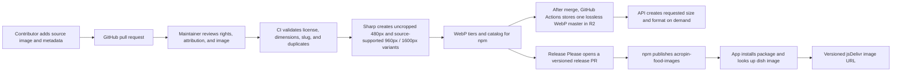

# `acropin-food-images`

An open, community-maintained catalog of food images for restaurant menus and food applications. Images keep their original aspect ratio and full frame. The npm package includes WebP tiers with maximum edges of 480 px, and 960 px / 1600 px when the source supports them. Each tier is encoded directly from the original without a forced file-size target or upscaling. Catalog entries include dish name, category, tags, source, and per-image license information.

## Install

```sh
npm install acropin-food-images
```

## Use an image in a menu

```tsx
import { getFoodImage } from 'acropin-food-images';

const image = getFoodImage('margherita-pizza');

export function MenuItem() {
  return image ?  : null;
}
```

The initial catalog is empty. Until a matching contribution is reviewed, released, and installed, this lookup returns `undefined` and the component renders no image.

You can also use the URL helper or search by text, tag, and license:

```ts
import { getFoodImageUrl, searchFoodImages } from 'acropin-food-images';

const url = getFoodImageUrl('margherita-pizza', 960);
const vegetarian = searchFoodImages('pizza', { tags: ['vegetarian'] });
```

## Use the managed live API

Restaurant developers can request a free API key by emailing [manish.rathaur.dev@gmail.com](mailto:manish.rathaur.dev@gmail.com?subject=Acropin%20Food%20Images%20API%20access). Each approved restaurant receives its own read-only key and strict usage limits. Never put the maintainer's owner key in an app. For browser applications, a customer key can be inspected by users, so use a server-side proxy if the key must remain private.

```ts
import { createFoodImageClient } from 'acropin-food-images';

const images = createFoodImageClient({
  baseUrl: process.env.ACROPIN_FOOD_API_URL!, // Cloudflare Worker origin
  apiKey: process.env.ACROPIN_FOOD_API_KEY!, // free key supplied by the maintainer
});

const firstPage = await images.search('pizza', { limit: 20 });
const { assets } = firstPage;
const pizza = assets[0];
const imageUrl = pizza?.variants[960]?.url ?? pizza?.variants[480]?.url;
if (firstPage.nextOffset !== null) {
  const nextPage = await images.search('pizza', { limit: 20, offset: firstPage.nextOffset });
}
```

The API returns signed URLs for on-demand 128, 480, 960, and 1600 px maximum-edge images when the source has enough pixels, along with the contributor/creator, source, license, and attribution. It stores one lossless WebP master in R2 and generates the requested size and WebP, AVIF, JPEG, or PNG format when fetched; it does not save a copy for each size or format. The default page size is 24 and the maximum is 50; use `nextOffset` to fetch later catalog pages. Links expire after 15 minutes; call `list()` or `get(slug)` again if an image URL expires. The API requires contact approval. Community contributors submit pull requests; approved merges sync the catalog and single master to the managed API automatically once its deployment secrets are configured.

Image URLs point to the immutable npm package version on jsDelivr. Metadata is available locally from `foodImages` or `./catalog.json`; the 480 px WebP can be imported with `acropin-food-images/assets/<slug>.webp`, and variants with `acropin-food-images/assets/<slug>/<size>.webp` in bundlers that support asset imports.

The npm package and its images remain public/open source under each image's `CC0-1.0` or `CC-BY-4.0` license. Restaurant developers who need the managed catalog API must contact the owner for a free, individually rate-limited API key. API approval does not change the license or restrict direct downloads of images already published in npm.

## How community images reach the package



Contributors add one folder under `contributions/` containing exactly one source image and a `metadata.json`. Start from [`contributions/_template/metadata.json`](contributions/_template/metadata.json); replace its placeholder folder and values. The CI job checks the contribution when a pull request is opened. A maintainer reviews its rights and attribution before merging. Merged changes are grouped into an automated version release; merging the release PR publishes the new package version.

The web app's menu image library also reads the generated package catalog. Images added through the app's upload screen remain app-managed uploads; they are not automatically added to this npm package. Community package images must arrive through a reviewed GitHub pull request.

## Image and licensing requirements

- Source images may be JPEG/JPG, PNG, WebP, AVIF, TIFF, or HEIF/HEIC. The CI pipeline normalizes each approved source to a lossless WebP master for the shared API.
- Submit an image you created, or an image for which you have documented rights to redistribute under `CC0-1.0` or `CC-BY-4.0`.
- Include a working HTTPS source URL, creator/rightsholder, and image-specific license evidence URL. For `CC-BY-4.0`, provide the required attribution text.
- Do not contribute Unsplash, Pexels, stock-site, or other images unless the rightsholder explicitly grants redistribution rights for this image library and the evidence is included. A site's general download license is not evidence that images can be repackaged into a competing image catalog.
- Provide a clear food photo at least 300 × 300 px, with a longest edge of at least 480 px, and no larger than 15 MB. CI keeps the original source in the contribution folder and creates metadata-stripped WebP files directly from it. Outputs preserve the complete image and its aspect ratio, do not upscale, and use high quality without shrinking quality to hit an arbitrary byte limit. 960 px and 1600 px npm tiers are created only when the source longest edge supports them. Do not commit generated output.
- Use a unique lowercase kebab-case folder slug, such as `margherita-pizza`.

See [`CONTRIBUTING.md`](CONTRIBUTING.md) for the full checklist and release flow.

## Current catalog

The initial package contains no images. The existing demo images are not included because their redistribution rights have not been verified for npm distribution. The catalog will fill as reviewed contributions are merged and released.

## License

Package source and build tooling are Apache-2.0. Each image carries its own license and attribution in the generated catalog; check the image's `license` and `attribution` before use.
